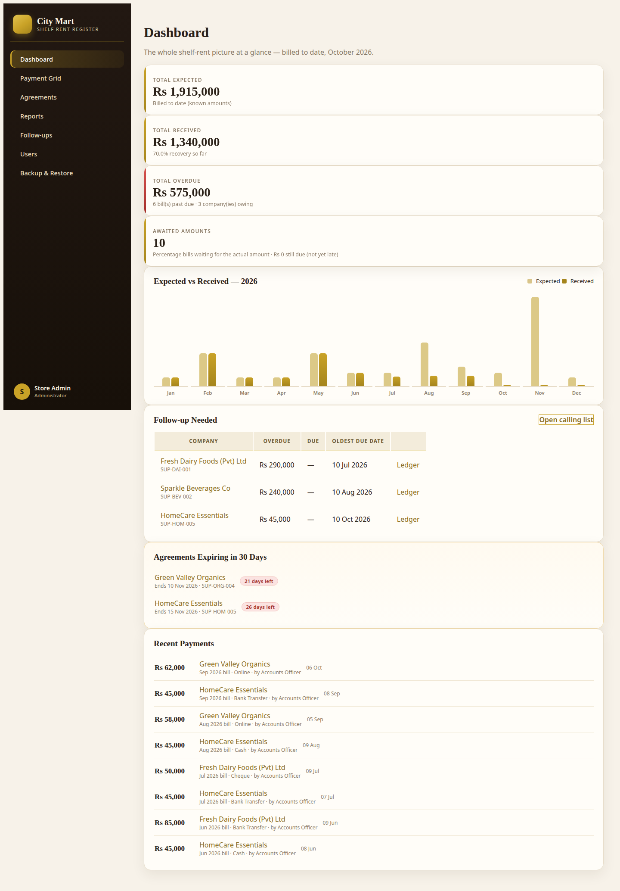
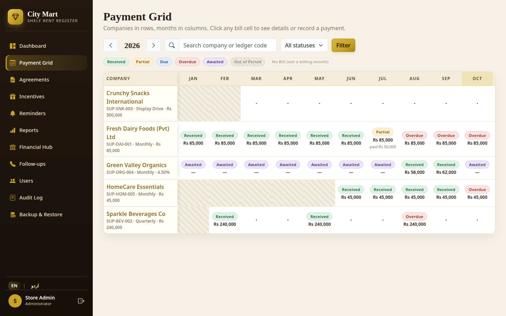
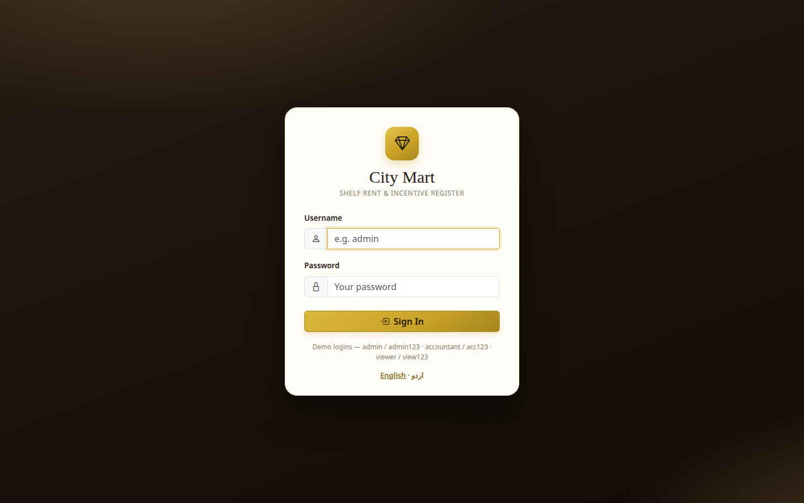
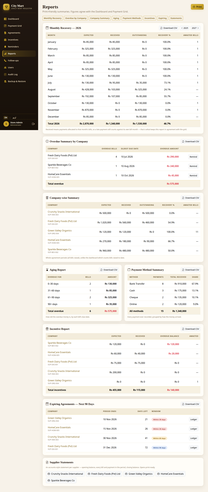
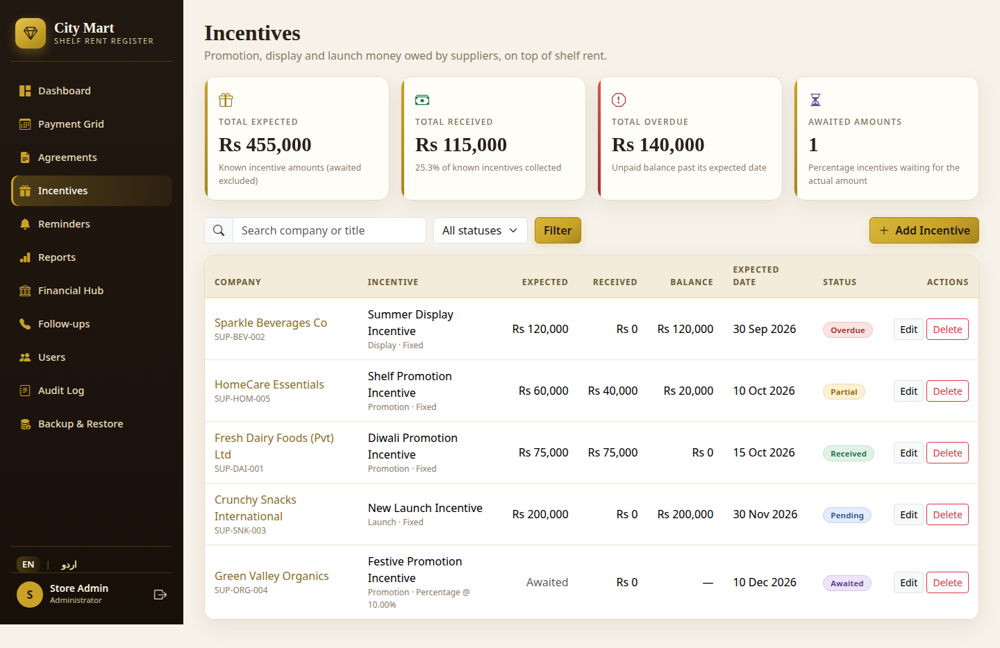
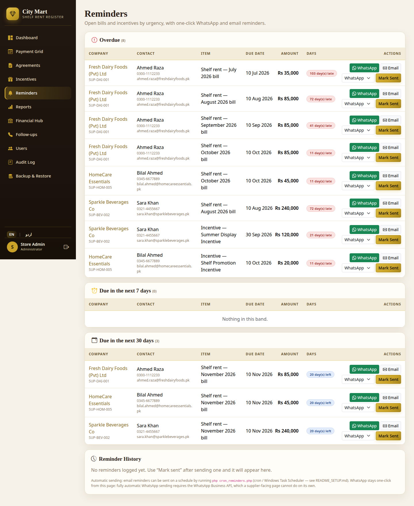
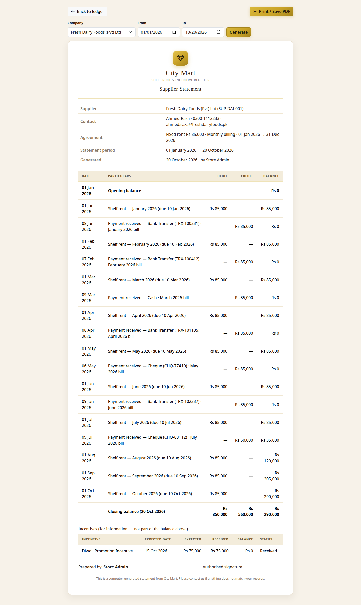
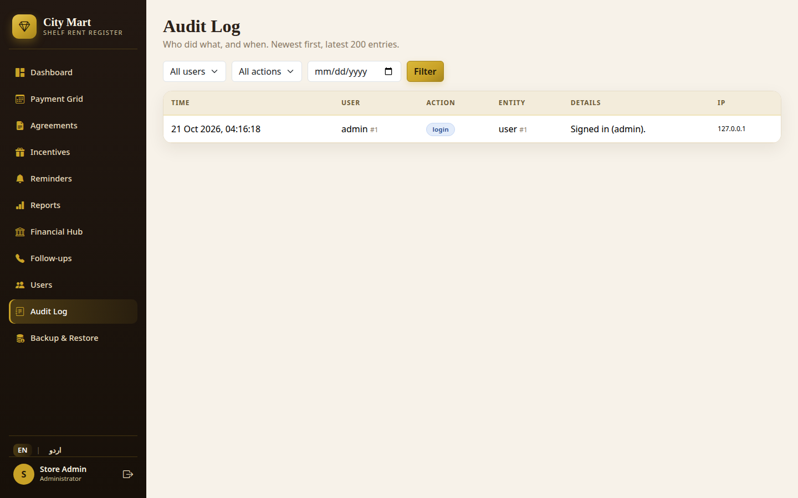
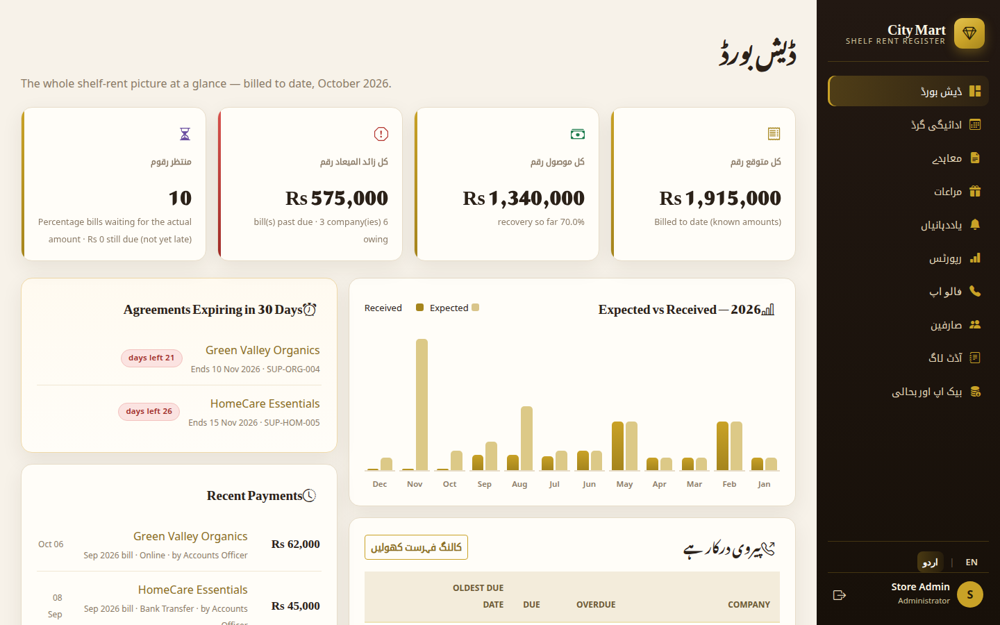
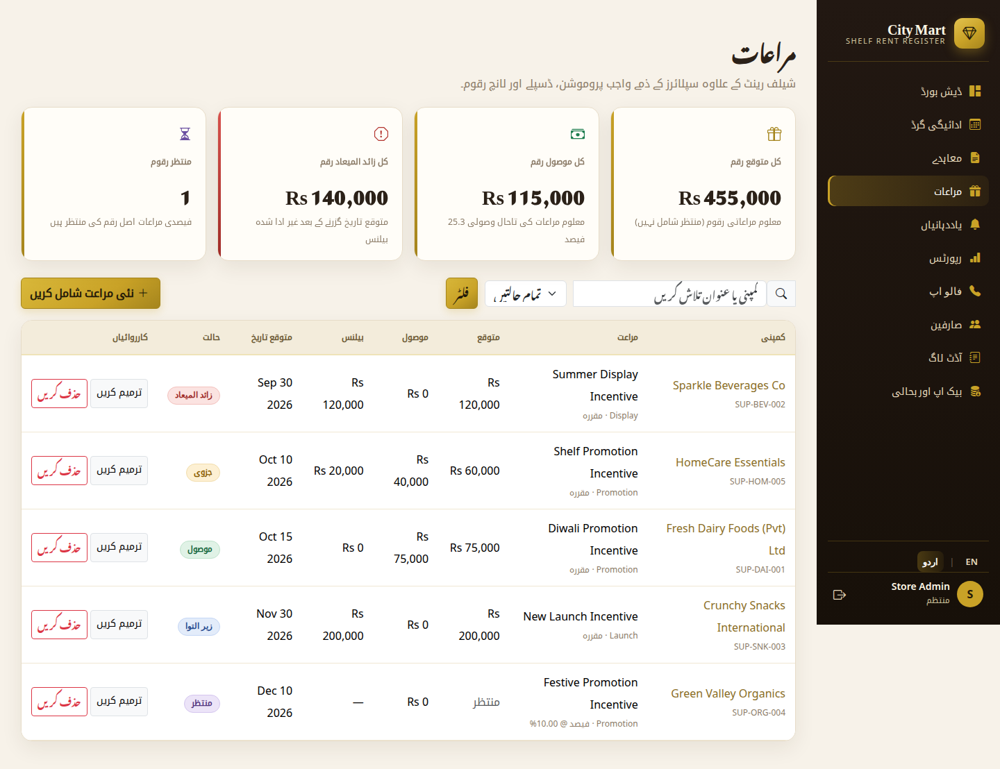

# Shelf Rent & Incentive Register

A complete, working web application for a retail mart that charges supplier
companies rent for shelf and display space. It replaces the manual notebook /
spreadsheet with a proper multi-user register that always answers three
questions instantly:

1. **Which companies have paid for this month?**
2. **How much is overdue, and from whom?**
3. **Which agreements are ending soon?**

  

## Screenshots

| Dashboard | Payment Grid |
|---|---|
|  |  |
| Monthly expected vs received chart, headline totals, follow-ups, expiring agreements | Companies × months with colour-coded bill statuses |

| Sign In | Reports |
|---|---|
|  |  |

| Incentives | Reminders |
|---|---|
|  |  |
| Promotion / display / launch money on top of rent, with the same status engine | Overdue + due-soon items with one-click WhatsApp and email reminders |

| Supplier Statement | Audit Log |
|---|---|
|  |  |
| Accounts-style statement with running balance, print / PDF clean | Who did what, and when (Admin only) |

| Dashboard in Urdu (RTL) | Incentives in Urdu (RTL) |
|---|---|
|  |  |
| Full EN/اردو toggle — UI chrome translated, figures unchanged | Same toggle on every page — headings, labels and notes included |

## What's new in v4

- **Deep Slate / Emerald luxury theme** with a **dark / light toggle**
  (remembered, no flash on load) — Urdu RTL fully styled in both modes.
- **Formal Tax Invoice** per bill (NTN/STRN from Settings, GST/WHT lines,
  net payable, QR code), a per-agreement **WHT % / GST % tax engine**
  (default 0 — every existing total unchanged), and a Tax Summary report.
- **Cheque (PDC) register** with due-this-week panel and
  Pending → Cleared / Bounced / Returned tracking (audit-logged).
- **Visual Shelf Map** — occupied / vacant / expiring shelf tiles.
- **Supplier Portal** — suppliers log in and see only their own balances,
  statement, invoices and agreement, download their contract scan, and
  upload payment slips for staff verification.
  Demo supplier login: `supplier / supp123` (Fresh Dairy Foods).
- **Percentage sales CSV import** that fills awaited percentage bills.
- **CSRF protection on every form**, Chart.js dashboard charts, live
  search, pagination, toasts, and a mobile card view for the grid.
- **WhatsApp Cloud API plumbing** (Settings) — inactive until the mart
  connects its own WhatsApp Business API account; one-click wa.me
  remains the default. Upgrading a v3 database: run `upgrade_v4.sql`.

## Features

- **Dashboard** — total expected / received / overdue, recovery %, monthly
  expected-vs-received bar chart, follow-up table, "expiring in 30 days"
  alert panel, recent payment activity.
- **Payment Grid** — companies in rows, months in columns, year navigation,
  search + status filters. Every cell shows its status: **Received, Partial,
  Due, Overdue, Awaited** (percentage bills), **Out of Period** and
  **No Bill** are all visually distinct. Click a cell to see the bill, its
  payment history, record a payment, or enter a percentage bill's amount.
- **Agreements** — add / edit / delete with ledger code, contact details,
  scanned signed-agreement upload (PDF/JPG/PNG, stored on the server).
- **Company Ledger** — one page per company: agreement, all bills, all
  payments, balances.
- **Billing engine** — monthly, quarterly (every third month from the period
  start) and Display Drive (once, at period end) frequencies; due date on the
  10th of the billed month; partial payments supported; percentage agreements
  stay **Awaited** — never shown as a false overdue figure — until staff enter
  the actual billed amount. One shared engine feeds the dashboard, grid and
  reports, so every total agrees.
- **Incentives** — promotion / display / launch / target money suppliers
  owe on top of rent. Fixed or percentage basis (percentage stays
  **Awaited** until the actual amount is known), part-received supported,
  with its own dashboard panel and per-company ledger section.
- **Reports hub** — monthly recovery, overdue by company, company-wise
  summary, aging report (0–30 / 31–60 / 61–90 / 90+ days), payment-method
  summary, incentive report and expiring agreements (30/60/90 days) —
  **every report downloadable as CSV**, all print-clean.
- **Supplier statements** — accounts-style statement per company and
  period: opening balance, bills and payments in date order with a
  running balance, closing balance. Print / Save-as-PDF ready.
- **Reminders** — overdue and due-soon bills + incentives with one-click
  WhatsApp (pre-written `wa.me` message) and email reminders, a sent-log,
  and a schedulable CLI script (`cron_reminders.php`) that emails due
  reminders automatically. (Background WhatsApp needs the WhatsApp
  Business API; here it is one-click by design.)
- **Audit log** — logins, payments, agreements, users, incentives,
  backups and reminder sends, recorded with user, IP and timestamp;
  Admin-only, filterable.
- **Urdu language toggle** — switch the whole interface between English
  and Urdu (full RTL, Nastaliq type) from the sidebar; data values and
  figures stay identical.
- **Printable payment receipt** after every recorded payment.
- **Follow-up calling list** — companies sorted by overdue amount, with
  contact names and phone numbers.
- **Roles enforced on the server** — Admin (full access + user management +
  backup/restore), Accountant (agreements + payments, no delete, no users),
  Viewer (read-only). Passwords are hashed with `password_hash()`.
- **Backup & Restore** — admin-only one-click `.sql` export and restore.

## Tech stack

| Layer    | Technology                                  |
|----------|---------------------------------------------|
| Frontend | HTML5, CSS3, JavaScript, Bootstrap 5        |
| Backend  | PHP 8.x (plain PHP, PDO, prepared statements) |
| Database | MySQL 8 / MariaDB 10.4+                     |
| Runs on  | XAMPP locally, cPanel shared hosting live   |

## Quick setup (XAMPP)

1. Copy this folder into `htdocs/` (e.g. `htdocs/shelf-rent-register/`).
2. Start **Apache** and **MySQL** in the XAMPP control panel.
3. Open **phpMyAdmin → Import** and import `database.sql`
   (or run `mysql -u root -p < database.sql`).
   This creates the database `shelf_rent_register`, all tables, the default
   users and a full sample data set.
4. If your MySQL user/password differ from `root` / _(empty)_, edit the
   `DB_*` constants at the top of `config.php`.
5. Visit `http://localhost/shelf-rent-register/` and sign in.

Full step-by-step instructions, including live-hosting notes, are in
[README_SETUP.md](README_SETUP.md). Design decisions and the reasoning behind
the billing rules are in [ONE_PAGE_NOTE.md](ONE_PAGE_NOTE.md).

## Default logins

| Role       | Username     | Password   |
|------------|--------------|------------|
| Admin      | `admin`      | `admin123` |
| Accountant | `accountant` | `acc123`   |
| Viewer     | `viewer`     | `view123`  |
| Supplier   | `supplier`   | `supp123` (portal only, Fresh Dairy Foods) |

> Change these passwords immediately on any real deployment (Users page,
> Admin only).

## Project layout

```
index.php            Dashboard
grid.php             Payment grid (companies × months)
agreements.php       Agreement list + filters + delete
agreement_form.php   Add / edit agreement (+ scan upload)
company.php          Company ledger (agreement, bills, payments)
receipt.php          Printable payment receipt
invoice.php          Formal tax invoice per bill (QR, print = PDF)
statement.php        Supplier statement (printable, running balance)
cheques.php          Cheque (PDC) register — due this week, bounce tracking
shelfmap.php         Visual shelf map (occupied / vacant / expiring)
settings.php         Mart NTN/STRN + WhatsApp Cloud API settings (Admin)
portal.php           Supplier portal (own company only, slip uploads)
portal_download.php  Supplier's own contract scan download (scoped)
sales_import.php     Percentage sales CSV import (fills awaited bills)
reports.php          Reports hub (10+ reports, all with CSV downloads)
reports_export.php   CSV export for every report
followups.php        Follow-up calling list
incentives.php       Incentive list + totals (+ delete, Admin)
incentive_form.php   Add / edit incentive
reminders.php        Reminder centre — WhatsApp/email + sent log
cron_reminders.php   CLI-only automatic email reminders (schedule it)
audit.php            Audit log viewer (Admin)
payment_action.php   All payment write actions (server-side checks)
users.php            User management (Admin)
backup.php           Backup export / restore (Admin)
login.php logout.php Authentication
billing.php          Billing + incentive engines — statuses, totals
auth.php             Sessions, role guards, CSRF, escaping, audit()
lang.php             EN/Urdu dictionary + language toggle
db.php config.php    PDO connection + all settings (DB_* constants)
layout.php           Shared luxury sidebar layout (RTL-aware)
assets/css/app.css   Theme (Deep Slate / Emerald luxury, light + dark)
assets/js/app.js     Theme toggle, toasts, count-up, live search
assets/vendor/       Vendored Bootstrap, Chart.js, qrcodejs (no CDN needed)
uploads/             Scanned agreements (PHP execution disabled)
database.sql         Schema + default users + sample data (fresh install)
upgrade_v2.sql       v1 → v2 upgrade (existing installs only)
upgrade_v4.sql       v3 → v4 upgrade (existing installs only)
```

## Sample data at a glance

Five suppliers cover every case: monthly fixed (with a partial payment and
overdue months), quarterly fixed (one quarter overdue), a Display Drive
agreement (single end-of-period bill), a percentage agreement (Awaited bills,
two months entered and paid) and a short agreement expiring within 30 days.
Each supplier also carries one sample incentive — Received, Overdue, Pending,
Awaited and Partial — with hand-checkable totals (expected Rs 455,000 ·
received Rs 115,000 · overdue Rs 140,000 · awaited 1). Already running v1?
Import `upgrade_v2.sql` instead — see README_SETUP.md.
